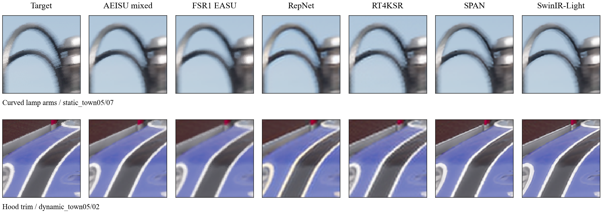

# AEISU

### Tensor Core-Accelerated Inverse Supersampling for Real-Time Game Upscaling

[](LICENSE)

AEISU is a compact, single-frame **2x neural upscaler**. A low-resolution controller predicts local filter coefficients;
the reconstruction head applies those filters directly to the original RGB neighborhood. The design keeps neural
processing below the input resolution and supports a mixed FP8/FP16 Tensor Core deployment.

By **Charles Dale B. Gleason**, independent researcher and primary maintainer.

[Main paper](paper/inverse_supersampling.pdf) · [Supplement](paper/inverse_supersampling_supplement.pdf) ·
[Model card](MODEL_CARD.md) · [Optimized runtimes](optimized/README.md) · [Windows demo source](desktop_demo/README.md)

## What is here?

- Portable PyTorch training, export, inference, and evaluation, including CPU support.
- Area-trained, bicubic-control, and DIV2K L1 checkpoints.
- Windows CUDA Tensor Core and conventional-CUDA INT8/FP16 runtime sources.
- A minimal SDR desktop demo source with one mixed-precision model.
- Research protocols, compact numerical records, and the manuscript.

Built for graphics researchers and developers exploring practical real-time neural upscaling.
Bug reports, reproducibility checks, and contributions are welcome.

## Quick start

Use Python 3.11 or newer. The reference was validated with PyTorch 2.11.0, including its CUDA 13.0 build.

```powershell
uv add torch==2.11.0 --index https://download.pytorch.org/whl/cu130
uv add numpy pillow
python infer.py --checkpoint weights/aeisu_area.pt --input input.png --output result.png --device cuda
```

A CPU-only PyTorch installation works too:

```powershell
python infer.py --checkpoint weights/aeisu_area.pt --input input.png --output result.png --device cpu
```

The default tiled path limits memory use. Use `--tile 0` for full-frame inference.
Images are converted to RGB; the script does not apply antialiasing or tone mapping.

## Choose a checkpoint

| Checkpoint | Training | Intended comparison |
| --- | --- | --- |
| `weights/aeisu_area.pt` | Area-derived game pairs, MSE | Principal inverse-supersampling model |
| `weights/aeisu_bicubic.pt` | Bicubic-derived game inputs, MSE | Training-degradation control |
| `weights/aeisu_div2k_l1.pt` | DIV2K bicubic, L1; 915,000 updates | Conventional natural-image SISR |

These are folded full-precision PyTorch checkpoints. The mixed FP8/FP16 deployment artifact is separately included
at `optimized/native/weights/adaptive_fp8.bin`; it is not interchangeable with a `.pt` checkpoint.

## Results and scope

The paper evaluates PSNR, SSIM, and LPIPS across several input degradations and reports matched architectural,
coefficient-clamp, output-head, and precision controls. Quality depends on the training/input distribution:
the manuscript reports the resulting distortion, perceptual-quality, and runtime trade-offs.

For example, the DIV2K L1 model reaches **31.630 dB on B100** and **30.365 dB on Urban100** in the paper's common
encoded-Y PSNR protocol. Its mixed deployment scores 31.621 and 30.346 dB respectively. These are quality results,
with runtime comparisons documented separately by implementation. Full tables and metric definitions are in the paper.

The principal model expects already-antialiased, tone-mapped, perceptually encoded RGB. It is spatial only:
it does not provide motion estimation, temporal accumulation, or an HDR pipeline. Native aliased game inputs can
favor conservative interpolation under PSNR. See the paper and model card for the measured trade-offs.



GameIR Town05, target-derived area inputs; original colors and nearest-neighbor crop display.
GameIR (Zhou et al., 2024), with CARLA Simulator asset attribution. See [image notices](paper/LICENSE.md).
This is an illustrative selection, not an estimate of artifact frequency. Numerical QRISP results remain in the
paper, but **QRISP image crops and the private dataset are not distributed in this public snapshot**.

## Train and evaluate

Prepared folders must have matching relative stems and exactly 2x target dimensions.

```powershell
python train.py --config configs/area.json --input data/input --target data/target --output runs/area --device cuda
python export.py --checkpoint runs/area/last.pt --output weights/my_model.pt --training-input area
python evaluate.py --checkpoint weights/aeisu_area.pt --input data/input --target data/target --output outputs/eval --device cpu
```

The portable recipe uses D4 augmentation, AdamW, cosine learning rate, and the documented fixed stride-16
base/bank gradient sampling. It preserves model mathematics but not the original fused arithmetic or exact crop
sequence. Training data are not bundled. CPU training is functional but slow; use `configs/cpu_smoke.json` for a small check.

LPIPS is optional: `uv add lpips`. Evaluation does not download its weights unless explicitly permitted.

## Hardware-specific paths

- [Tensor Core runtime](optimized/README.md): the measured custom mixed deployment targets Windows / RTX 5090 (SM 120a).
- [Conventional-CUDA runtime](optimized/shader): profile-selected INT8/FP16 kernels, separate from the portable path.
- [Desktop demo](desktop_demo/README.md): source only in this release; Windows SDR, RTX 50-series target.

The root inference script requires no custom compiler or kernels. Optimized code requires separately installed
vendor SDKs and is not validated on all NVIDIA architectures. Vendor SDK/runtime binaries are not bundled here.

## Development

```powershell
python -m unittest discover -s tests -v
```

Tests use CPU and synthetic data: phase packing, clamping, folding, sampled gradients, tiling, metrics,
augmentation, and train/resume/infer/evaluate behavior. See [CONTRIBUTING.md](CONTRIBUTING.md) for bug reports and PRs.

## License and citation

Author-owned code and released weights are **MIT**. Manuscript text and original figures are **CC BY 4.0**;
third-party imagery and dependencies retain their own rights and notices. See [LICENSE_SCOPE.md](LICENSE_SCOPE.md)
and [THIRD_PARTY.md](THIRD_PARTY.md).

Citation metadata are in [CITATION.cff](CITATION.cff). The manuscript is a research preprint;
no arXiv identifier, peer-review acceptance, or DOI is claimed.
